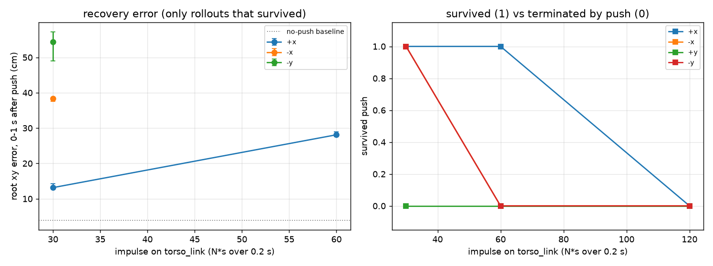
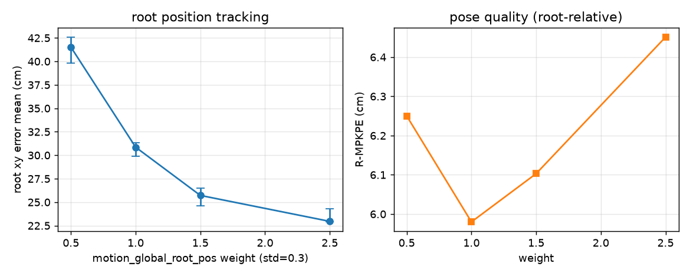

# supermimic-dsh — Unitree G1 动作模仿复现（纯仿真）

目标：在本地 WSL + RTX 3060 6GB 上，从零复现"人形机器人全身动作模仿"的最小可用闭环，并加入受控外力扰动实验。最终产出一个可解释、可重复、可交接的工程目录，而不是一次性 demo。

> 公开仓库：https://github.com/Overlume/g1-motion-tracking （代码 + 文档 + 小幅结果文件；不含权重与动作数据）
>
> 项目指令来源：`<外部 brief 文档>`（用户 brief，2026-11-11 读入）。
> 第一轮核验结论见 `docs/DECISIONS.md` 与 `docs/STATE.md`。

## 结果（截至 2026-11-20，完整版见 [docs/REPORT.md](docs/REPORT.md)）

| 阶段 | 内容 | 关键数字 |
| --- | --- | --- |
| 基线 | 官方预训练策略 | dance1 完成度 1.00、MPKPE 10.74 cm；格斗 S3 **5/5 摔倒**（中位 11.66 s） |
| 调参 | 根位置奖励权重 0.5→2.5（300 iter） | root 41.52 → 22.95 cm（−44.7%），但滑移 +42.5%、R-MPKPE U 形（1.0 最好） |
| 规模 | 300 → 3000 iter（weight 1.5） | root 25.72 → **3.90 cm（−84.8%）**，R-MPKPE 6.10 → 3.66，完成度 0.999 |
| 泛化 | 同一 ckpt 换窗口 | 训练片段 0.999 → held-out 窗口 **0.101**（最长存活 2.02 s） |
| 扰动 | torso_link 世界系 ±x/±y；冲量 40/45/60/80/90/120 N·s（力 200–600 N × 0.2 s），各 5 种子 | 终止阈值：+y 0.81 m/s 起出现倒地、0.90 m/s 多数倒地；结局（终止关、推后 3 s）：120 N·s（600 N）四方向 5 次里 4–5 次真倒地；冲量—倒地率单调；**20 种子后两向边界不同（D26）**：60 N·s 时 −y 19/20（95%，CI 75–100%）vs −x 6/20（30%，12–54%），Fisher p = 3.9e-5；80 N·s 两向都 20/20（下界 0.83）；5 种子的「80 起全倒」作废；同种子 3 遍测翻转率（LAB16，D28）：−x 60 翻 4/20、−y 60 翻 1/20 → 边界格改写 5–6/20 与 18–19/20；**−y 过渡区（LAB17，D30）**：45 N·s 三遍 11/11/12（58%，32–81%，翻转 3/20）、50 N·s 15/15/15（75%，51–91%，0/20）→ 50% 交点在 40–45 N·s 之间（插值 ≈44.3），「过渡在 45–60」作废；**−x 第二分点（LAB18，D31）**：70 N·s 三遍 14/11/10（中位 55%，包络 27–88%，翻转 4/20，全部 rep1 down→后两遍 transient）→ −x 的 50% 交点 ≈68 N·s（65–70），与 −y 的 ≈44 相差 ≈23–24 N·s |
| 可重复性 | 同配置同种子重跑 3 遍（−y 60 / 80 N·s × 5 种子） | 倒地数 **4/4/4 与 5/5/5**，倒地种子集合与唯一 transient 种子三遍完全不变 → 重跑噪声（判定层）= 0；数值层有位级抖动（骨盆最低 ±1.1 cm、末尾 root ±3 cm、最长偏离 ±0.34 s）；故 20% 差别是种子抽样而非重跑噪声，5/5 的 p(down) 下界仍为 0.48（D25） |

> 结论一句话：**3.90 cm 是“这个 20 s 窗口的专家成绩”，不是“学会了动作模仿”**；本仓库把两者分开报，并给了受控扰动下的失稳边界。





## 现在从哪里看

1. `docs/STATE.md` — 当前阶段、已验证事实、下一步最小动作。
2. `docs/PLAN.md` — 里程碑与验收标准。
3. `docs/DECISIONS.md` — 已做的路线/许可/环境决定及理由。
4. `docs/SOURCES.md` — 所有外部来源与核验日期。
5. `docs/ARTIFACT_INDEX.md` — 仓库、数据、模型、日志的实际位置。

## 目录

```
repos/        第三方仓库（只读，不改动其内部约定）
  mjlab_research/    mujocolab/mjlab v1.6.0（MuJoCo Warp 训练框架）
  supermimic/        HybridRobotics/supermimic（可微世界模型方法，进阶对比）
src/          本项目自己的代码（转换、评估、扰动）
scripts/      可重复执行的脚本（环境、数据、运行）
configs/      实验配置快照
data/         raw / processed / manifests（大文件不入 Git）
runs/         每次实验一个目录，含命令、配置、指标、视频
outputs/      videos / figures / reports
environment/  项目内隔离的 Python 环境与缓存
docs/         状态、计划、决策、来源、学习记录、交接
scratch/      临时探查（pdf、下载样本、实验性脚本）
```

## 快速开始（2026-11-14 实测可用）

```bash
# 1) 环境（项目内隔离：venv 在 environment/.venv，uv/Python 也下载到 environment/）
bash scripts/setup_env.sh

# 2) 回放官方预训练 checkpoint（单台）
MUJOCO_GL=egl environment/.venv/bin/python scripts/replay_policy.py \
  --checkpoint-file scratch/model_49999.pt \
  --motion-file data/processed/lafan_dance1_subject1.npz \
  --video-length 600 --num-envs 1 --width 960 --height 540

# 3) 4 台并排回放（取景默认自动装下所有 env）
MUJOCO_GL=egl environment/.venv/bin/python scripts/replay_policy.py \
  --checkpoint-file scratch/model_49999.pt \
  --motion-file data/processed/fight1_s3_000s_20s.npz \
  --video-length 400 --num-envs 4 --width 960 --height 540 --tag demo4

# 4) 量化评估（输出 runs/<dir>/summary.json + metrics.csv）
MUJOCO_GL=egl environment/.venv/bin/python scripts/eval_tracking.py \
  --motion-file data/processed/fight1_s3_000s_20s.npz \
  --seed 101 --keep-dr --ignore-terminations \
  --out runs/YYYYMMDD-001-eval
```

### 取景参数（2026-11-14 新增，旧命令不用改）

| 参数 | 默认 | 作用 |
| --- | --- | --- |
| `--camera` | `follow` | follow=相机跟着所有机器人的中心并自适应距离；fit=静态装下网格；auto=mjlab 原来的跟随相机 |
| `--camera-margin` | 1.3 | 取景余量，越大相机越远 |
| `--camera-elevation` | -16 | 相机仰角（度） |
| `--camera-azimuth` | 45 | 相机方位角（度），45=斜对棋盘格 |
| `--camera-min-distance` | 5.2 | follow 模式距离下限，越大越不容易被摔倒的机器人切边 |

背景：mjlab 默认 `viewer.max_extra_envs=2`，只渲染「主 env + 2 个邻居」，所以 4 个 env 只显示 3 台机器人（与分辨率无关）；`--camera auto` 走 tracking 模式跟随单台，env 散开后容易出画。修复说明见 `docs/STATE.md` 的「取景修复」一节。

## 文档地图

- `docs/COMPLETION_CRITERIA.md` — 项目「完成」的判定条件、必跑实验、不在范围内的事项
- `docs/GITHUB_UPLOAD_PLAN.md` — 上传清单、`.gitignore`、提交划分、上传前检查
- `docs/learning/` — 带练 LAB（用户亲手做的实验记录）
- `docs/handoffs/HANDOFF.md` — **唯一**交接文档（**仅本地**，已写入 `.gitignore`；换会话只带这一份即可接手）
